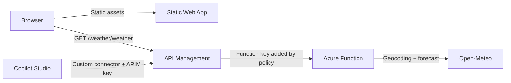

# Weather, simply

A small full-stack Azure sample: a Static Web App and a Copilot Studio custom connector call the same TypeScript Azure Function through Azure API Management. The function geocodes a city and returns current conditions from Open-Meteo.



The browser API is read-only, public, and rate-limited by caller IP at the gateway. The Copilot API requires an API Management subscription key. Neither client receives the Azure Function key; API Management stores it as a secret named value and adds it when forwarding requests.

## Repository layout

| Path | Purpose |
| --- | --- |
| `api/src/domain` | Weather types, route name, and city input rules |
| `api/src/services` | Open-Meteo geocoding/forecast adapter |
| `api/src/functions` | Azure Functions HTTP adapter |
| `api/openapi` | Backend and Copilot Studio OpenAPI 2.0 contracts |
| `api/test` | Offline service and contract tests |
| `web` | Static browser app |
| `infra/main.bicep` | Storage, Flex Consumption Function App, and Static Web App |
| `infra/apim.bicep` | API Management service, APIs, secret, and policies |
| `infra/deploy.ps1` | End-to-end PowerShell deployment |
| `docs/azure-configuration.md` | Portal setup and IaC mapping |

## Run and test locally

Prerequisites: Node.js 22, npm, Azure Functions Core Tools v4, and Azurite. The local storage emulator is used by the Functions host. Start it from the repository root with `azurite --silent --location ./.azurite`.

1. Start Azurite, then in `api` run:

   ```powershell
   Copy-Item local.settings.example.json local.settings.json
   npm ci
   npm test
   npm start
   ```

2. In `web`, run:

   ```powershell
   npm ci
   npm run dev
   ```

   Open the URL printed by Vite and search for a city. Core Tools doesn't enable the full authorization pipeline unless started with `--enableAuth`; in Azure the Function requires a key and API Management adds it server-side.

The service tests stub the provider and make no external requests. Check and build the web app with `npm run check` and `npm run build` from `web`. The function test command also checks that the route and required query parameter are represented in the OpenAPI contract.

## Deploy to Azure

The deployment requires an Azure subscription with permission to create a resource group, Azure Functions resources, role assignments, Static Web Apps, and API Management. Install Azure CLI, Bicep (`az bicep install`), Functions Core Tools, and Node.js 22, then sign in with `az login`.

From the repository root:

```powershell
.\infra\deploy.ps1 -ResourceGroupName rg-sd-weather-demo -Location westeurope -PublisherEmail you@example.com
```

The script deploys the Function App and Static Web App foundation, tests and publishes the function, provisions API Management, builds and deploys the site, and writes an API Management-hosted OpenAPI 2.0 document to `deploy-output/copilot-weather.openapi.json`. API Management Developer tier provisioning can take a while. **This sample creates billable resources; check current Azure pricing before deploying.**

## Connect Copilot Studio

1. In API Management, create a subscription scoped to the `Weather for Copilot Studio` API. Keep its primary key private.
2. In Power Apps, create a custom connector from `deploy-output/copilot-weather.openapi.json`. The definition uses OpenAPI 2.0 and declares the `Ocp-Apim-Subscription-Key` header.
3. Configure the connector's API-key authentication with that subscription key, test `GetCurrentWeather`, and save the connector.
4. In Copilot Studio, add the custom connector as a tool and provide the required city input.

The connector path is `/copilot-weather/weather`; the website uses `/weather/weather`. The two APIs share the same Function and business logic, but only the Copilot-facing API requires an APIM subscription.

## After the first deployment

- Open the Static Web App URL and request a known city.
- In API Management's test interface, call `GET /weather/weather?city=Paris`.
- Confirm that the public API returns `429` after its per-IP rate limit is reached; distributed throttling can be approximate.
- Call the Copilot API without a subscription key and confirm it is rejected, then test with the scoped key.
- Import the generated connector definition and test it from Copilot Studio. Portal labels and connector experiences can change; verify the current steps in your tenant.
- Inspect Function logs and API Management diagnostics for failed calls. The assistant has not deployed this sample to an Azure subscription.

## Design decisions and production changes

- **One domain, multiple adapters:** the Function validates input and maps provider data once. The website and Copilot connector are thin consumers of that API.
- **Open-Meteo without a key:** useful for a small educational demo, but its free API is limited to non-commercial use and requires attribution. Review the provider's current [terms](https://open-meteo.com/en/terms) before using it. For commercial use, select an appropriately licensed plan or provider.
- **Separate API Management surfaces:** the browser must not contain a shared APIM or Function secret. Its read-only API is public and rate-limited; the Copilot API requires an APIM subscription.
- **Flex Consumption:** the Function uses a system-assigned managed identity for host and deployment storage. The Function endpoint itself requires a function key, which is held in an encrypted APIM named value.
- **Demo, not production:** API Management Developer tier has no production SLA. IP-based throttling is not authentication and should not be treated as a security boundary. Before production, add an identity model appropriate to each caller, stronger abuse controls, monitoring/alerting, and a commercially licensed weather source. Review current tier support and costs.
- **No live deployment verification:** only local tests/builds can be performed without Azure credentials. Verify resource provisioning, real portal screens, connector import, and deployed behavior in your tenant.

## Cost and cleanup

Azure resource prices vary by region, usage, and tier. API Management Developer is a billable non-production tier; Functions, storage, and Static Web Apps can also incur charges depending on configuration and usage. Review the current Azure pricing pages before deploying.

When finished, delete the dedicated resource group and verify that its resources are removed:

```powershell
az group delete --name rg-sd-weather-demo --yes --no-wait
```

Do not use a resource group containing unrelated resources.

## License

MIT. Open-Meteo weather data remains subject to its own licensing and terms.
