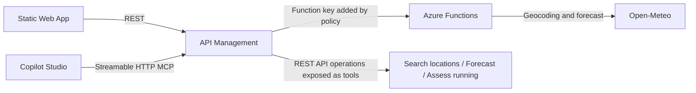

# Weather plans

A small full-stack Azure sample for one useful question: **Should I go running in Barcelona tomorrow?** A Static Web App and a Copilot Studio MCP client use the same TypeScript Azure Function through Azure API Management. The Function resolves city names, retrieves a daily forecast from Open-Meteo, and applies transparent demo thresholds.

## Start here / Empieza aqui

**[Guia completa en espanol: de REST a MCP y Copilot Studio](docs/guia-completa.md)**. Companion guide for the blog: architecture, local setup, deployment, manual APIM changes, agent instructions, end-to-end validation, lessons learned, and ideas to extend the sample.

| Your goal | Read |
| --- | --- |
| Understand and reproduce the full example in Spanish | [Complete walkthrough](docs/guia-completa.md) |
| Run only the API and web locally | [Local setup](#run-and-test-locally) |
| Deploy the base infrastructure | [Azure deployment](#deploy-to-azure) |
| Configure MCP, authentication, and query templates | [Azure operational reference](docs/azure-configuration.md) |

This is a self-hosted sample, not a shared hosted service. Local API/web execution does not need an Azure subscription; cloud deployment and Copilot Studio require your own environments and can incur costs. **The deployment script does not create the MCP server or agent, and does not apply the manual APIM URL-template workaround.**

## Architecture



APIM exposes the REST operations as MCP tools; the Function itself is not an MCP server. That keeps the domain logic independent of the caller and lets the web UI and agent share the same behavior. In APIM, create or update the MCP server after the APIs are deployed, selecting the operations you want the agent to use.

## API tools

| Operation | Purpose | Example |
| --- | --- | --- |
| `SearchLocations` | Return up to ten city matches with region and country, so the user or agent can disambiguate names. | `GET /weather/locations?query=Lleida` |
| `GetCurrentWeather` | Return current conditions. | `GET /weather/weather?city=Barcelona&country=Spain&admin1=Catalonia` |
| `GetDailyForecast` | Return min/max temperature, precipitation, wind and condition for a date. | `GET /weather/forecast?city=Barcelona&date=YYYY-MM-DD&country=Spain&admin1=Catalonia` |
| `AssessRunningConditions` | Apply explicit running thresholds to the daily forecast and explain the result. | `GET /weather/running-assessment?city=Barcelona&date=YYYY-MM-DD&country=Spain&admin1=Catalonia` |

In examples above, `/weather` is the public APIM API path. For a Copilot MCP based on the subscription-protected API, use the same operation paths under `/copilot-weather` when configuring or testing REST operations. The MCP endpoint itself is generated by APIM and ends in `/mcp`; copy the exact Server URL from the APIM portal.

Replace `YYYY-MM-DD` with today or a date in the following six days. Search locations first and use the returned city, country, and region rather than combining them into one city string.

The running assessment recommends a run only when the full-day forecast is within these demo thresholds: minimum temperature at least 5 °C, maximum temperature at most 30 °C, precipitation at most 2 mm, and maximum wind at most 25 km/h. The API returns both the thresholds and reasons. This is a transparent demo heuristic, not medical advice or an official safety warning.

## Repository layout

| Path | Purpose |
| --- | --- |
| `api/src/domain` | Weather contracts, date/city validation, and assessment thresholds |
| `api/src/services` | Open-Meteo geocoding and forecast adapter, city resolution, and assessment logic |
| `api/src/functions` | HTTP adapters for the four Azure Function operations |
| `api/openapi` | OpenAPI 2.0 definitions for APIM and the optional custom connector |
| `api/test` | Offline service and OpenAPI contract tests |
| `web` | Static browser client for location search, forecast, and running assessment |
| `infra/main.bicep` | Storage, Flex Consumption Function App, and Static Web App |
| `infra/apim.bicep` | APIM service, public and subscription-protected REST APIs, and policies |
| `infra/deploy.ps1` | End-to-end PowerShell deployment |
| `docs/guia-completa.md` | Spanish blog companion: full walkthrough, lessons, and extension ideas |
| `docs/azure-configuration.md` | Portal setup and IaC mapping |

## Run and test locally

Prerequisites: Node.js 22, npm, Azure Functions Core Tools v4, and Azurite. The local storage emulator is used by the Functions host. Start Azurite from the repository root:

```powershell
azurite --silent --location .\.azurite
```

In a second terminal, start the Function:

```powershell
Set-Location api
if (!(Test-Path local.settings.json)) {
  Copy-Item local.settings.example.json local.settings.json
}
npm ci
npm test
npm start
```

In a third terminal, start the web client:

```powershell
Set-Location web
npm ci
npm run dev
```

Open the Vite URL. Search for city matches first if a name may be ambiguous, then choose current weather, forecast, or running assessment. The selected city and region are saved in browser storage and reused until the city field is edited, including after a page refresh. Core Tools doesn't enable the full authorization pipeline unless started with `--enableAuth`; in Azure the Function requires a key and APIM adds it server-side.

`api/local.settings.json` must have `FUNCTIONS_WORKER_RUNTIME` set to `node` for Core Tools to identify the local TypeScript worker. This local setting must not be added to the Flex Consumption Bicep app settings.

Run the API tests with `npm test` in `api`; they stub Open-Meteo and don't call external services. Run `npm run check` and `npm run build` in `web`.

`npm test` compiles the API. After changing API TypeScript, rebuild with `npm run build` in `api` and restart the host as needed; no compiler watch process is configured.

## Deploy to Azure

The deployment requires an Azure subscription with permission to create a resource group, Azure Functions resources, role assignments, Static Web Apps, and API Management. Install Azure CLI, Bicep (`az bicep install`), the latest Azure Functions Core Tools v4, and Node.js 22, then sign in with `az login`.

From the repository root:

```powershell
.\infra\deploy.ps1 -ResourceGroupName rg-sd-weather-demo -Location westeurope -PublisherEmail you@example.com
```

The script deploys the Function App and Static Web App foundation, tests and publishes the Function, provisions APIM with two REST API surfaces, builds and deploys the site, and writes an OpenAPI 2.0 file to `deploy-output\copilot-weather.openapi.json` for the optional custom connector route. APIM Developer tier provisioning can take a while. **This sample creates billable resources; check current Azure pricing before deploying.**

## Create the MCP server and connect Copilot Studio

After deployment:

1. Configure the REST operation URL templates using the [tested MCP workaround](docs/azure-configuration.md#configure-rest-operation-templates-for-mcp). This avoids malformed optional query parameters observed in APIM's generated MCP calls. It makes country and region required on the affected Copilot REST operations, without changing the public API or Function.
2. In the Azure portal, open the API Management instance. Under **APIs → MCP Servers**, choose **Create MCP server → Expose an API as an MCP server**.
3. Select **Weather for Copilot Studio**. Expose `SearchLocations`, `GetDailyForecast`, and `AssessRunningConditions` as tools; optionally include `GetCurrentWeather`. Give the server a clear name and create it. For subscription-based access, associate both the MCP server and its source REST API with the same protected APIM product and enable **Subscription required** on both.
4. Copy the generated **Server URL** from the MCP server. It is not the REST URL; it ends with `/mcp`.
5. In Copilot Studio, open the agent's tools and add a new **Model Context Protocol** tool. Paste the Server URL and configure the matching authentication. For an APIM subscription, use API-key authentication in the `Ocp-Apim-Subscription-Key` header and an active subscription to that product, then create the connection and add the server to the agent.
6. Add the [suggested agent instructions](docs/azure-configuration.md#suggested-agent-instructions) and try: “¿Me conviene salir a correr mañana en Barcelona?” Ask the agent to search locations if a city is ambiguous.

APIM exposes REST operations as MCP tools; it doesn't turn the Function source code into MCP. APIM's current MCP support exposes tools, not MCP resources or prompts. The optional custom connector is a separate REST integration path and is not required when connecting directly to an MCP server. Portal labels and Copilot Studio availability can change; verify the current [APIM MCP guide](https://learn.microsoft.com/azure/api-management/export-rest-mcp-server) and [Copilot Studio MCP guide](https://learn.microsoft.com/microsoft-copilot-studio/mcp-add-existing-server-to-agent).

## After deployment

- Open the Static Web App URL and try location search, current conditions, a date forecast, and a running assessment.
- Check the REST endpoints through APIM; the Copilot API requires a valid APIM subscription.
- In APIM, verify the MCP tool list includes the intended operations, then copy its Server URL into Copilot Studio.
- Test an ambiguous city name and confirm the API returns suggestions rather than silently choosing an arbitrary match.
- Inspect Function logs and APIM diagnostics for failed calls. Validate an actual MCP tool execution: successful initialization and tool listing alone do not prove the underlying REST call works.

## Design decisions and production changes

- **One domain, multiple callers:** the Function owns city resolution and assessment logic; the web app and Copilot are thin consumers.
- **Explainable rule:** the API returns the inputs, thresholds, and reasons behind the running recommendation so the agent can present them rather than inventing criteria in a prompt.
- **City ambiguity is explicit:** geocoding returns candidates; optional country/region qualifiers resolve duplicate city names. Names are compared without case or diacritic sensitivity, and the Spanish exonym `Lérida` is mapped to the provider's `Lleida` search.
- **No extra stateful service:** the example needs no database or queue. The weather provider is called on demand.
- **Open-Meteo:** its free API is limited to non-commercial use and requires attribution. Review the provider's current [terms](https://open-meteo.com/en/terms) before using it; select an appropriately licensed plan/provider for commercial use.
- **Demo, not production:** APIM Developer is not a production tier with an SLA. IP throttling is not authentication. Before production, add an identity model appropriate for each caller, stronger abuse controls, monitoring/alerting, and a commercially licensed weather source. The running thresholds are examples, not safety guidance.
- **Tenant-specific setup:** the manual MCP URL-template workaround was verified with real tool calls and Copilot Studio. The deployment script does not automate those portal changes; verify them after each deployment or API import.
- **Date boundary:** the API currently validates the seven-day range against the server's UTC date, while forecasts use the location's time zone. Local-day boundaries can differ near midnight.

## What this example teaches

Keep business decisions in an API, expose focused operations as tools, and let the agent compose calls and explain returned evidence. The most important integration lesson was to distinguish successful MCP discovery from a successful tool execution: HTTP `200` and `isError: false` did not always mean the underlying REST operation succeeded.

The [complete guide](docs/guia-completa.md) records the problems encountered and their verified fixes, along with non-implemented extension ideas such as additional activities, identity-based access, observability, and automated MCP integration tests. The repository includes runnable source and deployment assets, not a finished production platform or raw tenant screenshots.

## Before publishing a fork or screenshots

Keep deployment outputs, local settings, credentials, and archives out of Git. The supplied example settings contain only local-development values. `VITE_` variables are embedded in public browser code: never put a key or token in them.

Review both the current tree and Git history before changing repository visibility. Rotate any credential shared in chat, logs, screenshots, or past commits; deleting a file or masking a screenshot does not revoke a key. Redact account emails, tenant/subscription identifiers, deployment hostnames, and any visible credentials from screenshots before committing them. This sample does not include tenant-specific screenshots or a shared live endpoint.

Restore subscription protection on both the MCP server and its source REST API after anonymous diagnostics. The web API is intentionally public and rate-limited; publishing source code is separate from making an Azure endpoint anonymous. See the [publication checklist](docs/azure-configuration.md#publication-checklist).

## Cost and cleanup

Azure resource prices vary by region, usage, and tier. API Management Developer is a billable non-production tier; Functions, storage, and Static Web Apps can also incur charges. Review current Azure prices before deploying.

When finished, verify that the resource group contains no unrelated resources, then delete the dedicated group:

```powershell
az group delete --name rg-sd-weather-demo --yes --no-wait
```

## License

MIT. Open-Meteo weather data remains subject to its own licensing and terms.
