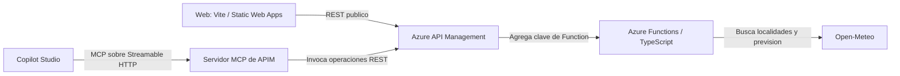

# De una API REST a herramientas MCP con Azure y Copilot Studio

Esta guia acompana al ejemplo del blog y permite reproducirlo en tu propia suscripcion. La pregunta de partida es sencilla: **"Me conviene salir a correr manana en Barcelona?"** Lo interesante no es generar una respuesta convincente, sino conseguir que el agente use datos reales y una regla de negocio verificable.

El repositorio contiene la API, la web, los contratos OpenAPI, las pruebas y la infraestructura. No incluye credenciales, capturas del tenant ni un servicio compartido que debas usar. Necesitas desplegar tus propios recursos; los nombres de las herramientas y algunas etiquetas del portal pueden variar.

## 1. Que hemos construido y por que

Partimos de una consulta de tiempo actual y ampliamos el ejemplo con busqueda de localidades, prevision diaria y evaluacion de condiciones para correr. La web y Copilot Studio reutilizan la misma logica.



**La Function no implementa MCP.** Expone cuatro operaciones HTTP y APIM las presenta como herramientas. El modelo elige herramientas y explica resultados; la API valida entradas, resuelve localidades y calcula la recomendacion.

| Pieza | Responsabilidad | Donde leerla |
| --- | --- | --- |
| Dominio | Contratos, validacion y umbrales | [`api/src/domain/weather.ts`](../api/src/domain/weather.ts) |
| Adaptador meteorologico | Geocodificacion, desambiguacion y llamadas a Open-Meteo | [`api/src/services/openMeteo.ts`](../api/src/services/openMeteo.ts) |
| Adaptadores HTTP | Parametros de entrada y errores HTTP/JSON | [`api/src/functions/weather.ts`](../api/src/functions/weather.ts) |
| Contratos | Importacion en APIM y conector REST opcional | [`api/openapi`](../api/openapi) |
| Web | Seleccion de localidad y visualizacion | [`web/src/main.ts`](../web/src/main.ts) |
| Infraestructura | Recursos Azure, gateway y despliegue | [`infra`](../infra) |

No hay base de datos, cola ni modelo ejecutandose dentro de la Function. Las consultas al proveedor se hacen bajo demanda.

## 2. Que hace cada herramienta

| Operacion REST | Parametros | Resultado |
| --- | --- | --- |
| `/locations` | `query` | Hasta diez localidades con nombre, pais, region, coordenadas y zona horaria |
| `/weather` | `city`, `country`, `admin1` | Tiempo actual, sensacion termica, humedad, lluvia y viento |
| `/forecast` | Los anteriores y `date` | Minima, maxima, precipitacion, viento maximo y estado del cielo |
| `/running-assessment` | Los mismos de prevision | Recomendacion, motivos, umbrales, prevision y aviso de limitaciones |

En la Function y en la API publica, `country` y `admin1` son opcionales. Si una ciudad es ambigua, hay que resolverla mediante la busqueda. El workaround MCP del apartado 5 hace obligatorios ambos campos en las operaciones afectadas de la API de Copilot.

La regla devuelve `recommended` solo si se cumplen **todos** estos limites, incluidos sus extremos:

| Dato diario | Criterio de demostracion |
| --- | --- |
| Temperatura minima | Al menos 5 grados C |
| Temperatura maxima | Como maximo 30 grados C |
| Precipitacion | Como maximo 2 mm |
| Viento maximo | Como maximo 25 km/h |

`reasons` enumera los limites incumplidos; esta vacio cuando todos se cumplen. No son criterios medicos ni una garantia de seguridad. Una prevision diaria tampoco permite afirmar a que hora concreta llovera.

Las fechas usan `YYYY-MM-DD` y el rango de hoy a seis dias despues. **Limitacion actual:** la validacion del rango usa el dia UTC del servidor; la prevision usa la zona horaria de la localidad. Cerca de medianoche puede haber diferencias con el dia local del usuario. No se ha implementado una validacion del rango por zona horaria.

## 3. Ejecutar el ejemplo localmente

Necesitas Node.js 22, npm, Azure Functions Core Tools v4 y Azurite disponibles en el equipo. No necesitas Azure ni Copilot Studio para probar la API y la web locales.

Desde la raiz del repositorio, prepara los dos proyectos:

```powershell
npm ci --prefix api
npm ci --prefix web
if (!(Test-Path .\api\local.settings.json)) {
  Copy-Item .\api\local.settings.example.json .\api\local.settings.json
}
npm test --prefix api
npm run check --prefix web
npm run build --prefix web
```

Abre tres terminales, todas inicialmente en la raiz. El orden importa:

| Terminal | Comando | Funcion |
| --- | --- | --- |
| 1 | `azurite --silent --location .\.azurite` | Almacenamiento local usado por el host |
| 2 | `npm start --prefix api` | Azure Functions en el puerto 7071 |
| 3 | `npm run dev --prefix web` | Vite; abre la URL que muestra |

`npm test` compila la API antes de ejecutar las pruebas. Tras editar TypeScript, vuelve a compilar con `npm run build --prefix api` y reinicia el host si hace falta. No hay un compilador en modo watch configurado.

Vite redirige `/api` a `http://127.0.0.1:7071`; no hay un servidor MCP local. Core Tools no activa la autorizacion completa salvo que se arranque con `--enableAuth`. En Azure, los endpoints de la Function requieren clave.

Prueba una busqueda, selecciona Barcelona en Catalonia, Spain, y consulta la prevision o la evaluacion. La web guarda la localidad seleccionada en `localStorage`; conserva la seleccion al recargar y la borra cuando editas el nombre de ciudad.

## 4. Desplegar tu propia infraestructura

Necesitas Azure CLI, Bicep, Core Tools y permisos para crear recursos y asignar roles de almacenamiento. Para la parte del agente necesitas ademas un entorno Power Platform con acceso a Copilot Studio y a la integracion MCP.

```powershell
az login
az account set --subscription "<tu-suscripcion>"
az bicep install
.\infra\deploy.ps1 -ResourceGroupName rg-weather-blog -Location westeurope -PublisherEmail you@example.com
```

Sustituye el correo por tu contacto de publicador. Usa un grupo dedicado. El despliegue crea recursos facturables; APIM Developer no tiene SLA de produccion y puede tardar en aprovisionarse.

El script:

1. Crea almacenamiento, una Function Flex Consumption con Node.js 22 y una Static Web App.
2. Configura identidad administrada y roles para el almacenamiento de la Function.
3. Instala dependencias, ejecuta pruebas de API y publica la Function, con reintentos limitados.
4. Obtiene una clave de Function y la suministra a APIM como parametro seguro mediante un archivo temporal que elimina al terminar esa fase.
5. Crea APIM e importa la API dos veces: `weather`, publica para la web, y `copilot-weather`, con suscripcion obligatoria.
6. Aplica CORS, limite por IP y la clave de Function en el gateway; compila y publica la web apuntando a la API publica.
7. Genera un OpenAPI en `deploy-output` para el camino alternativo del conector REST.

**No crea automaticamente el servidor MCP, la conexion de Copilot Studio ni el workaround de plantillas.** El OpenAPI generado para un conector REST no se importa en el asistente de alta MCP.

Para el mapa detallado entre portal y Bicep, consulta [Azure configuration](azure-configuration.md). Si vuelves a desplegar, las importaciones pueden sobrescribir los ajustes manuales siguientes.

## 5. Preparar las operaciones REST para MCP

En el entorno probado, APIM descubria las herramientas correctamente pero componia mal algunas llamadas con parametros opcionales. Se observaron valores como `Barcelona?country=Spain` y errores `invalid_date` con una fecha correcta.

La llamada REST directa funcionaba con los mismos argumentos. El workaround verificado fue incluir todos los parametros en la plantilla de URL.

En **APIM > APIs > APIs > Weather for Copilot Studio > Design**, selecciona cada operacion y edita **Frontend**:

| Operacion | Plantilla |
| --- | --- |
| Tiempo actual | `/weather?city={city}&country={country}&admin1={admin1}` |
| Prevision | `/forecast?city={city}&date={date}&country={country}&admin1={admin1}` |
| Running | `/running-assessment?city={city}&date={date}&country={country}&admin1={admin1}` |
| Busqueda, sin cambios | `/locations?query={query}` |

Usa un unico `?` y `&` entre parametros. Si `country` y `admin1` quedan duplicados en **Query parameters**, elimina solo esas entradas y conserva las de **Template parameters**. Guarda cada operacion.

**Trade-off:** esos campos pasan a ser obligatorios en estas operaciones de Copilot. Utiliza los valores devueltos por la busqueda. Una localidad sin region requiere adaptar este workaround; no inventes una region. No hace falta modificar la API publica ni relajar la validacion de la Function.

Esto documenta un comportamiento observado, no una afirmacion de que todas las versiones de APIM tengan el mismo fallo. Revisa las plantillas despues de importar o desplegar de nuevo.

## 6. Exponer MCP y conectar Copilot Studio

En **APIM > MCP Servers > Create MCP server > Expose an API as an MCP server**:

1. Selecciona **Weather for Copilot Studio** y sus cuatro operaciones.
2. Asigna un nombre, por ejemplo `weather-planning-mcp`, y una descripcion del proposito.
3. Para proteger el servicio, incluye el MCP y la API REST origen en el mismo producto protegido. Activa **Subscription required** en ambos y crea o utiliza una suscripcion activa a ese producto.
4. Copia la **Server URL** generada por APIM. Termina en `/mcp`; no es la URL base de la API REST.

En **Copilot Studio > Tools > Add a tool > Model Context Protocol**:

1. Introduce nombre, descripcion y la Server URL.
2. Selecciona **Clave API**, ubicacion **Encabezado**, nombre `Ocp-Apim-Subscription-Key`.
3. Introduce una clave de la suscripcion del producto, no una clave de Function ni la suscripcion global all-access.
4. Crea o selecciona la conexion y agrega las herramientas al agente.

La clave se guarda en la conexion, nunca en el prompt, el repositorio o el frontend. La Function tiene su propia clave y APIM la agrega hacia el backend; son credenciales diferentes.

Durante el diagnostico se probo acceso anonimo con **Ninguno**, desactivando temporalmente el requisito en ambos recursos. No es la configuracion recomendada para dejar publicado el endpoint. Un `401 missing subscription key` dentro del resultado de una herramienta puede venir de la API REST aunque el MCP admita conectar sin clave.

## 7. Instrucciones para el agente

Puedes utilizar este texto como punto de partida. Adapta los nombres si APIM genera otros; en el entorno probado la busqueda aparecia como `findMatchingCitiesAndRegions`.

```text
Usa las herramientas MCP meteorologicas como fuente de datos.
Busca primero la localidad y conserva city, country y admin1 por separado,
con los valores devueltos. Si hay ambiguedad, pregunta al usuario;
no deduzcas su ubicacion a partir de su nombre.
Envia todos los campos obligatorios del esquema.
Usa fechas YYYY-MM-DD dentro del rango admitido. Interpreta hoy/manana
con la fecha actual y la zona horaria de la localidad.
Para preguntas sobre correr, usa la herramienta de evaluacion y presenta
su recomendacion, motivos, umbrales y aviso de que es una demostracion.
Inspecciona el contenido por si contiene errores, aunque isError sea false.
Si parametros validos producen un error tecnico, informa del fallo.
No inventes causas, no pruebes variantes arbitrarias y no sustituyas
silenciosamente el servicio por busquedas web.
No presentes una interpretacion de la prevision como una evaluacion
de running completada.
```

El prompt mejora el comportamiento del agente, pero **no repara URLs ni autenticacion**. Para una demo centrada en las herramientas, desactiva la busqueda web si no quieres una fuente alternativa.

## 8. Validar de extremo a extremo

Empieza por la API, despues MCP y finalmente el agente. Asi distingues un problema de datos de un problema de transporte o configuracion.

### REST

Para validar localmente sin credenciales:

```powershell
$base = "http://127.0.0.1:7071/api"
$date = (Get-Date).ToUniversalTime().ToString("yyyy-MM-dd")
Invoke-RestMethod "$base/locations?query=Barcelona"
Invoke-RestMethod "$base/forecast?city=Barcelona&date=$date&country=Spain&admin1=Catalonia"
Invoke-RestMethod "$base/running-assessment?city=Barcelona&date=$date&country=Spain&admin1=Catalonia"
```

Para probar la ruta protegida en Azure, usa tu base `https://<tu-apim>.azure-api.net/copilot-weather` y envia `Ocp-Apim-Subscription-Key` desde una variable de entorno o un almacen de credenciales. No pruebes autenticacion solo contra la API publica.

### MCP

Usa un cliente compatible con Streamable HTTP y configura la Server URL y su encabezado de autenticacion. Comprueba tres fases, siguiendo el ciclo de inicializacion y sesion del cliente:

| Fase | Que demuestra | Que no demuestra |
| --- | --- | --- |
| `initialize` | Acceso al endpoint y negociacion MCP | Que funcione la API REST origen |
| `tools/list` | Descubrimiento y esquema de herramientas | Que los parametros se construyan bien al ejecutar |
| `tools/call` | Ejecucion real | Exito de negocio si no inspeccionas el contenido |

Ejemplo del mensaje de invocacion; usa el nombre real de tu herramienta y una fecha actual:

```json
{
  "jsonrpc": "2.0",
  "id": 3,
  "method": "tools/call",
  "params": {
    "name": "getTheDailyForecastForACity",
    "arguments": {
      "city": "Barcelona",
      "country": "Spain",
      "admin1": "Catalonia",
      "date": "YYYY-MM-DD"
    }
  }
}
```

En las respuestas observadas, APIM devolvia HTTP `200` e `isError: false` incluso cuando `content[].text` contenia un JSON con `401` o `invalid_date`. El exito real requiere encontrar los campos de prevision o evaluacion, no solo un codigo de transporte correcto.

### Copilot Studio y web

Prueba "Me conviene salir a correr hoy en Barcelona, Cataluna, Espana?" y revisa las entradas y salidas de las herramientas en la traza. Debe haber una localidad resuelta y una evaluacion con `recommendation`, `thresholds`, `reasons` y `forecast`. Los datos exactos cambiaran: las capturas del blog son una ejecucion de ejemplo, no un resultado fijo.

Prueba tambien un nombre ambiguo, una fecha fuera del rango y la persistencia de la localidad en la web. Las pruebas automatizadas son offline y verifican contratos, resolucion de ciudades, validacion, reintentos y limites de la regla; no sustituyen la validacion del despliegue real.

## 9. Problemas encontrados y aprendizaje

| Problema | Que hicimos | Idea reutilizable |
| --- | --- | --- |
| La app no tenia scripts para ejecutarse desde Copilot | Incorporamos `.github/github-app.yml` con preparacion y sesiones separadas | Documentar tambien como arrancar el proyecto |
| Core Tools no identificaba correctamente el worker | Fijamos `FUNCTIONS_WORKER_RUNTIME=node` solo en configuracion local | Flex define el runtime en `functionAppConfig.runtime`, no con ese app setting |
| Publicacion Flex y roles de almacenamiento | Configuramos almacenamiento de paquetes, identidad administrada y reintentos limitados | Las asignaciones pueden tardar en propagarse |
| El boton de running apuntaba a una ruta inexistente | Alineamos la accion con `running-assessment` | Un contrato correcto no garantiza que la UI lo use |
| Fallos transitorios del proveedor | Dos intentos, timeout por intento y errores explicitos | No ocultar errores con datos inventados |
| Ciudades ambiguas y seleccion perdida al recargar | Busqueda, calificadores y persistencia local; alias Lerida/Lleida | Resolver entidades antes de ejecutar una accion |
| Descubrimiento MCP correcto y ejecucion con `401` | Revisamos por separado autenticacion MCP y REST | Probar una llamada completa, no solo el handshake |
| Fechas validas fallaban solo por MCP | Comparamos con REST y aplicamos las plantillas completas | Inspeccionar parametros efectivos antes de cambiar validaciones |
| El agente probaba variantes y terminaba buscando en la web | Instrucciones de errores, fuentes y uso de evaluacion | El prompt delimita comportamiento, no sustituye arreglos tecnicos |

Los mensajes genericos de alta de servidor en Copilot Studio no permitieron demostrar una causa unica. No asumimos que cambiar el nombre o recrear la conexion los resuelva: conviene revisar la respuesta de red y el diagnostico del entorno sin compartir tokens.

## 10. Ideas para el blog y para ampliar el ejemplo

El hilo conductor puede ser: **API existente > contrato explicito > gateway > herramientas > agente > validacion real**. No hace falta reescribir la logica como un servidor MCP propio para explorar este patron.

| Idea | Lo que demuestra el ejemplo | Siguiente paso posible, no implementado |
| --- | --- | --- |
| Una regla fuera del prompt | La recomendacion es verificable y compartida con la web | Versionar reglas por actividad |
| Herramientas pequenas y componibles | Buscar, consultar y evaluar son operaciones distintas | Anadir otras actividades con contratos propios |
| Gateway como frontera | Claves, CORS y throttling fuera del frontend | OAuth/Entra ID, cuotas y observabilidad |
| Diagnostico por capas | Separa protocolo, autenticacion y negocio | Pruebas automatizadas de MCP y alertas |
| Infraestructura reproducible | Bicep y script para el despliegue base | Automatizar MCP y workaround cuando sea viable |

Para ilustrarlo, son utiles capturas de la arquitectura, las plantillas REST corregidas, la creacion de MCP, el encabezado configurado sin valor visible, las instrucciones y una ejecucion final con trazas. No estan incluidas en este repositorio: sanea correos, identificadores, claves y hostnames antes de publicarlas.

## 11. Limites, costes y cierre

APIM Developer es un nivel de demostracion facturable, sin SLA de produccion. La API de la web es publica; CORS y limite por IP no equivalen a autenticacion. La version gratuita de Open-Meteo requiere atribucion y tiene condiciones de uso no comercial: revisa sus [terminos](https://open-meteo.com/en/terms) o usa un proveedor/plan adecuado.

No hay cobertura de alertas oficiales, salud, calidad del aire, rutas ni prevision por hora. No esta automatizada toda la configuracion del portal. No se incluyen pruebas de integracion cloud, ni una garantia de disponibilidad o exactitud del proveedor.

Al terminar, verifica que el grupo contiene unicamente recursos de este ejemplo. El siguiente comando **elimina todos los recursos del grupo indicado**:

```powershell
az group delete --name rg-weather-blog
```

Espera a que finalice y comprueba la eliminacion en Azure. Elimina tambien conexiones o herramientas obsoletas en Copilot Studio; borrar Azure no las retira automaticamente. Consulta la [checklist de publicacion](azure-configuration.md#publication-checklist) antes de compartir tu fork o sus capturas.

## Referencias

- [README y mapa del repositorio](../README.md)
- [Referencia operativa de Azure y troubleshooting](azure-configuration.md)
- [Exponer una API REST como MCP en APIM](https://learn.microsoft.com/azure/api-management/export-rest-mcp-server)
- [Proteger servidores MCP en APIM](https://learn.microsoft.com/azure/api-management/secure-mcp-servers)
- [Conectar un servidor MCP a Copilot Studio](https://learn.microsoft.com/microsoft-copilot-studio/mcp-add-existing-server-to-agent)
